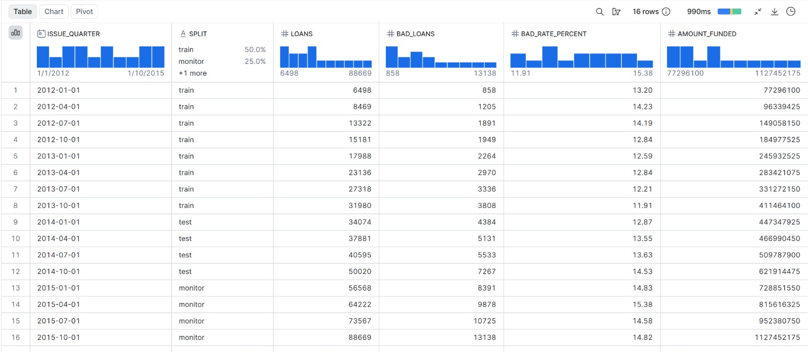
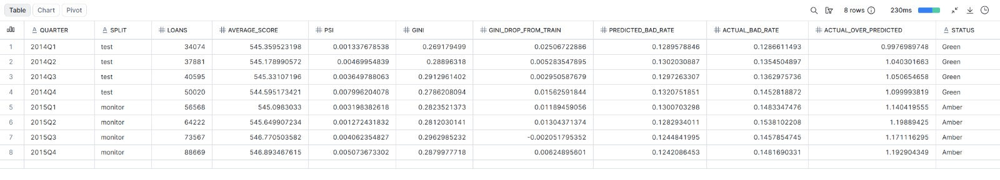

# Credit Risk Model Lifecycle

A full credit risk project on public personal loan data. It covers the same work a risk modelling team does: prepare data, build a scorecard, test a machine learning challenger, estimate expected credit loss, and monitor the model over time. A Streamlit app shows the results.

**Live app:** https://sriram-credit-risk.streamlit.app/

## What it does

1. Loads 2.2 million Lending Club loans into Snowflake and builds a clean modelling table with SQL.
2. Builds a credit scorecard with weight of evidence bands and logistic regression.
3. Builds a gradient boosted challenger with direction rules, and compares the two models.
4. Estimates expected credit loss on the 2015 loan book under three economic cases.
5. Monitors the scorecard by quarter for stability, ranking power and accuracy.
6. Serves it all in an app where you can score an applicant and see the reasons.

## Results

Run on 589,488 loans. Train 143,892, test 162,570, monitor 283,026.

1. Bad rate: 12.7 percent in training, 13.7 percent in the test year, 14.9 percent in the monitor year.
2. Scorecard test Gini 0.283 and KS 0.203. Training Gini is 0.294, so the model is not overfitted.
3. Challenger test Gini 0.321 and KS 0.233. The gain over the scorecard is 0.038 Gini.
4. Base case expected loss rate on the 2015 book is 5.8 percent. The actual loss rate was 7.4 percent. The downside case (7.2 percent) is the closest to what happened.
5. Monitoring: scores stayed stable (PSI below 0.01 in every quarter) and Gini held between 0.27 and 0.30. The model under predicted bad loans in 2015. The actual bad rate was 14 to 20 percent above the predicted rate, so all four 2015 quarters are amber.

The main finding: the model kept ranking borrowers well, but its level went out of date. Borrowers with the same score defaulted more often in 2015 than in 2012 and 2013. A stability check alone would have missed this. The fix in practice is to recalibrate the model on recent loans.

## Snowflake

The raw loans are loaded into `CREDIT_RISK.RAW.LOANS` (2,260,668 rows). The modelling table and a quarterly summary are built in SQL, and the monitoring results are written back to Snowflake.

**Bad rate by quarter** (`CREDIT_RISK.MART.BAD_RATE_BY_QUARTER`)



The bad rate falls from 14.2 percent in mid 2012 to 11.9 percent at the end of 2013, then rises to around 15 percent through 2015. Loan volume grows more than ten times over the same period.

**Model monitoring** (`CREDIT_RISK.MART.MONITORING`)



Scores stay stable in every quarter (PSI below 0.01) and Gini holds between 0.27 and 0.30, but the actual bad rate runs 14 to 20 percent above the predicted rate in 2015, so those quarters are flagged amber.

## How the data is split

Only 36 month loans issued from 2012 to 2015 are used. Every one of these loans has finished by the end of the data, so each has a known result.

1. Train: loans issued in 2012 and 2013
2. Test: loans issued in 2014
3. Monitor: loans issued in 2015, checked quarter by quarter

A loan counts as bad when its final status is Charged Off.

## How to run it

### 1. Install

```
pip install -r requirements.txt
```

### 2. Check your setup with made up data (optional)

```
python tests/make_test_data.py
python 01_prepare_and_load.py tests/test_loans.csv
python 02_build_model_table.py
python 03_train_scorecard.py
python 04_train_challenger.py
python 05_expected_loss.py
python 06_monitoring.py
streamlit run app.py
```

The made up data is random. Use it only to confirm the code runs. Do not publish results from it.

### 3. Get the real data

Download the Lending Club accepted loans file (2007 to 2018) from Kaggle. The file is named `accepted_2007_to_2018Q4.csv` and is about 1.6 GB.

### 4. Connect to Snowflake

Snowflake no longer accepts a plain password from scripts, so the project signs in with a programmatic access token.

1. Run `sql/setup_snowflake.sql` once in a Snowsight worksheet. It creates the warehouse `CREDIT_RISK_WH`, the database `CREDIT_RISK` and the schemas `RAW` and `MART`.
2. Change the user name in `sql/setup_access_token.sql` to yours, then run it in Snowsight. The last statement returns the token. It is shown only once.
3. Copy `.env.example`, name the copy `.env`, fill in your account identifier and user name, and paste the token into `SNOWFLAKE_PASSWORD`.

The `.env` file is in `.gitignore`, so the token is never uploaded. If `.env` is missing, every step still runs on your computer without Snowflake.

### 5. Run the steps on the real data

```
python 01_prepare_and_load.py path/to/accepted_2007_to_2018Q4.csv
python 02_build_model_table.py
python 03_train_scorecard.py
python 04_train_challenger.py
python 05_expected_loss.py
python 06_monitoring.py
```

Step 1 creates the database `CREDIT_RISK` and loads the table `RAW.LOANS`.
Step 2 runs `sql/build_model_table.sql` to create `MART.LOANS_MODEL`.
Step 6 writes the monitoring results to `MART.MONITORING`.

### 6. Run and deploy the app

```
python pin_versions.py
streamlit run app.py
```

To put it online:

1. Push this repo to GitHub. Include the `models` and `outputs` folders. The `data` folder is ignored because it is large.
2. Go to Streamlit Community Cloud and sign in with GitHub.
3. Create a new app, choose this repo, and set the main file to `app.py`.
4. Choose the same Python version you used to train.

The app reads the saved model files, so it stays online after the Snowflake trial ends.

## Files

1. `common.py` holds shared settings, the feature list and helper functions.
2. `01_prepare_and_load.py` tidies the raw file and loads it into Snowflake.
3. `sql/build_model_table.sql` builds the modelling table.
4. `02_build_model_table.py` runs the SQL and saves the result locally.
5. `03_train_scorecard.py` builds the scorecard.
6. `04_train_challenger.py` builds the challenger and compares the models.
7. `05_expected_loss.py` estimates expected credit loss.
8. `06_monitoring.py` produces the quarterly monitoring results.
9. `app.py` is the Streamlit app.
10. `pin_versions.py` records package versions for deployment.

## Method notes

**Leakage.** Only fields known at application are used. Grade and interest rate are left out because they are the lender's own risk rating. Payment fields are left out because they are only known after the loan starts.

**Scorecard.** Features with information value below 0.02 are dropped. Points are scaled so that 600 points equals odds of 50 to 1, and 20 points doubles the odds.

**Challenger.** LightGBM with early stopping. Credit score and income can only lower risk. Debt to income and recent enquiries can only raise it. Feature contributions come from SHAP values.

**Expected loss.** Chance of default comes from the scorecard. Loss given default is the average share not recovered on defaulted training loans. Exposure is the amount funded.

**Monitoring.** PSI above 0.10 is amber and above 0.25 is red. A Gini fall of more than 0.03 from training is amber and more than 0.06 is red. An actual bad rate more than 10 percent away from the predicted rate is amber and more than 25 percent is red.

## Limits

1. The data is from the United States and ends in 2018. Results will not carry over to Australian lending.
2. Only approved loans are in the data. Rejected applicants are missing, so the model is biased toward people who passed the lender's own checks.
3. The chance of default covers the whole 36 month term, not a 12 month window.
4. Exposure is set to the full amount funded. In practice the balance falls as the loan is repaid, so expected loss here is on the high side.
5. The stress cases use fixed multipliers. They are not linked to real economic forecasts.
6. Quarterly Gini on small samples can move by chance.
